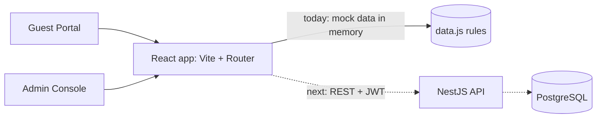
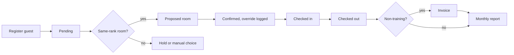

# Hostel & Guest House Management System: Frontend

React + Vite frontend implementing the Guest Portal and Admin Console from the HLD.

## Run
```
npm install
npm run dev
```
Open http://localhost:5173

## Milestone 1 (done)
- Guest Portal: confirm dates, declare accompanying people, generic availability only (no room or rate data)
- Admin Console: occupancy stats, allocation queue with rank-based proposals, same-rank sharing check, mandatory reason on overrides, room board, audit log
- Mock data in `src/data.js` (swap for NestJS REST calls later)

## Next
Login and roles (SuperAdmin / Front-Desk / Accounts), check-in/out, training extension approvals, billing invoices, monthly reports.

## Login and roles (Milestone 2)
Demo accounts (mock auth, sessionStorage): admin/admin123 (SuperAdmin), frontdesk/desk123, accounts/acc123 (read-only), sharma/guest123 and menon/guest123 (Guest, own booking only). Route guards live in `src/App.jsx`; replace `login()` in `src/auth.jsx` with the JWT API call later.

## Office theme
This folder is the same project (login, roles, allocation) with a sidebar-and-topbar office layout and a corporate blue theme. Only `src/App.jsx` and the end of `src/styles.css` differ from the classic folder.

## Guest registration (Milestone 3)
Front-Desk and SuperAdmin get a Guests tab: register a guest with identity, contact, stay and companion details, search the register, and open any row for full details. New registrations enter the Allocation queue as Pending.

## HLD traceability
Same feature set and traceability table as the classic folder (see its README).

## Official website edition
Same system, wrapped as an official site. Design references: GIGW 3.0 (Guidelines for Indian Government Websites and Apps), the Delhi Judicial Academy, Delhi High Court and Supreme Court of India websites.
Included: skip-to-content link, screen reader access link, A+ / A / A- text size, default and high-contrast theme, breadcrumb, main navigation, public Home / Stay rules / Contact pages, notices box, footer with Feedback, Privacy policy, Disclaimer and Help links, last-updated date, keyboard-friendly focus.
To do before real use: add the organisation's authorised emblem or logo (the crest here is a placeholder), Hindi/bilingual content, real contact details and policy text, then run an accessibility audit (WCAG 2.1 AA) and a security review. This edition follows the spirit of GIGW but is not certified compliant.

## Premium edition
Adds original SVG illustrations (academy building, reception, rooms, gardens, skyline), icon cards, a facts strip, numbered steps, and dashboard graphics (occupancy donut, stays-by-category bars, room pictures on the Rooms board). To use real photos, put `hero.jpg`, `reception.jpg`, `rooms.jpg` and `gardens.jpg` in `public/images/`; they replace the illustrations automatically.

## Enterprise edition (signed-in area redesigned)
Sidebar navigation with icons (one URL per section), top bar with global search (Ctrl+K) for pages and guests, notification bell for pending work, light and dark mode, an Overview dashboard (KPI cards, occupancy-per-day area chart, donut, category bars, needs-attention list, arrivals queue, recent activity), and a slide-over drawer for guest details. The public official site is unchanged.

## Final edition
New in this version: toast messages for every action, guest register with filter chips, sortable columns and pagination, room calendar, printable invoice, CSV export for the monthly report, date-aware room allocation (no double-booking on overlapping dates), masked ID numbers, sign-out after 15 minutes idle, sign-in lockout after 5 failed attempts, unit tests, Prettier.

```
npm test        # runs the allocation, billing and stay-window tests
npm run format  # formats the code with Prettier
```

### Architecture


### Stay lifecycle


### Not done yet (honest list)
Backend API and database, server-side validation, TypeScript, ESLint, end-to-end tests, Hindi/bilingual text, housekeeping status, and screenshots. The security items here (lockout, idle logout) are client-side demos; real enforcement belongs on the server.
